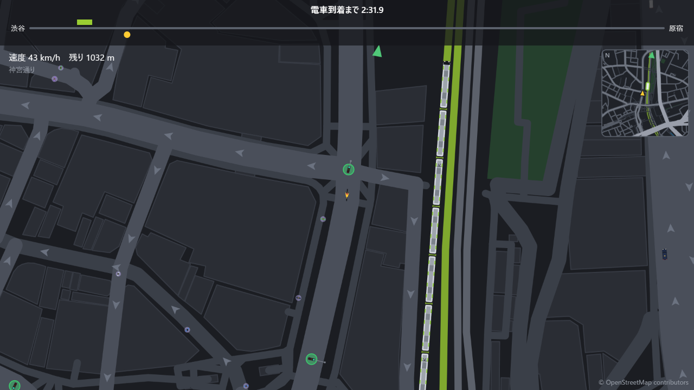
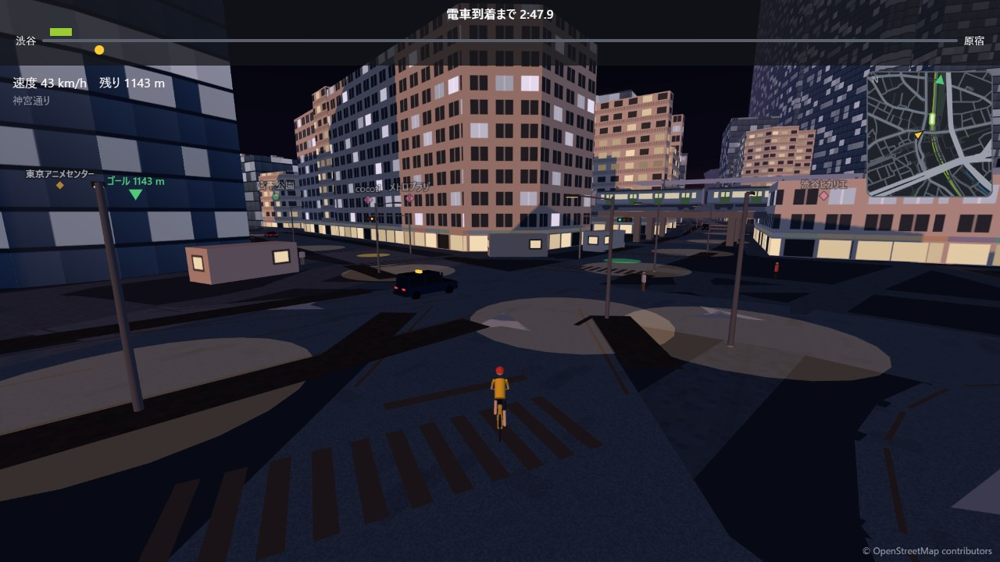

# 山手線に勝て！

東京の本物の道を自転車で走り、山手線より先に次の駅を目指すブラウザのレースゲームです。
山手線1周の全30区間を、真上から見下ろす **2D版** と、街を立体で走る **3D版（試作）** で遊べます。

> JR東日本とは関係のない非公式のファンゲームです。

| 2D版 | 3D版（試作） |
| --- | --- |
|  |  |

## 遊び方

山手線の隣り合う2駅の間を自転車で走り、電車が着く前（制限時間内）にゴール駅の緑の円に入れば勝ちです。前の区間に勝つと次の区間が開き、最後の恵比寿→渋谷に勝つと「山手線1周達成！」です。

- **道路**：OpenStreetMap の実際の道路。建物は壁、歩道と道路の外は遅くなります。
- **障害**：信号（赤で進入すると5秒停止）、一方通行の逆走（減速）、車（衝突で2秒停止）、歩行者（衝突で1秒停止）。
- **難易度**：かんたん・ふつう・むずかしい（制限時間の倍率が変わります）。
- **時間帯と天気**：昼・夕方・夜、晴れ・雨・雪を選べます。「天気の影響：あり」にすると、雨や雪で自転車が走りにくくなり、制限時間も延びます。3D版は雨の日に水たまりと合羽、雪の日に雪だるまと雪の山、夕方と夜は自転車のライトが灯ります。
- **季節（3D版）**：春・夏・秋・冬を選べます（見た目だけ）。春は若葉と桜の花びらと鯉のぼり、夏は七夕の笹飾りと風鈴と夜の花火、秋は紅葉とイチョウとハロウィンのかぼちゃ、冬はイルミネーションとクリスマスツリー、駅の入口の門松としめ飾り。晴れた日は遠くに富士山と雲、海の近くでは東京湾の船が見え、雨や雪がやむと虹が出ます。雨の日はときどき稲光と雷の音、晴れた夕方は沈む夕日、晴れた昼は遠くがもやでかすみます。秋は落ち葉が舞い、夏の晴れた昼は遠くの路面に陽炎。雨の日は水たまりで水しぶきが上がり、濡れた路面にタイヤの跡が残ります。
- **走りの演出（3D版）**：速く走ると画面の端に風の線が流れ、ベルを鳴らすと音符が出ます。
- **自転車の飾り（3D版）**：マフラー（走るとなびく）・買い物袋・花束を選べます（ロードバイクは背中のリュックに）。電動アシスト自転車は子ども乗せに子どもを乗せられます。
- **自転車と服**：自転車の種類（ロードバイク・ママチャリ・電動アシスト自転車）、服の色、ヘルメットの色を選べます。見た目だけで、速さや記録は変わりません。
- **ゴースト**：ベストタイムの走りを半透明の自転車で再生します。見た目は白・光る水色・山手線の黄緑・自分と同じ色から選べます。
- **軽さ（3D版）**：ふつう・軽い・とても軽いから選べます。軽くすると画面の細かさ・影・道を行き来する人や車の数・舞う花びらや落ち葉を減らし、数の多い飾り（墓石・掲示板など）を隠し、描く距離を短くします。区間選択画面に今の滑らかさ（fps）が出ます。どの設定でも、遠くの小物は描きません。
- **ゴールの演出（3D版）**：勝ってゴールすると、門のくす玉が割れて「祝 ゴール」のたれ幕が下り、紙吹雪が舞い、応援の人が跳びはねます。結果画面には表彰台に立つ自分。負けたときは、先に着いた電車のドアが開いて乗客が降りてきます。
- **街のにぎわい（3D版）**：電線のカラスや駅前のハト（近づくと飛び立つ）、ネコ、犬の散歩、神社のそばの縁日とおみこし、石焼いもや古紙回収の車、公園のキッチンカー、川を進む船。観光バスやタンクローリーなどの大きな車、工事現場の警備員、公園の人、配達の人、商店街のアーケード、繁華街の大型ビジョン。神社の鳥居と狛犬・お寺の山門、駅前の交番とタクシー乗り場、首都高（玉川通り・昭和通りなどの上）、赤ちょうちんの居酒屋と夜のラーメン屋台、電車の窓の乗客、ゴールで手を振る駅員さん。OpenStreetMap の位置に、学校（校門・遊具・下校する子ども）・ガソリンスタンド・コインパーキング・銭湯（煙突・のれん）・噴水・シェアサイクルのポート。線路沿いの撮り鉄、高いビルの航空障害灯、選挙と町内会の掲示板。病院・郵便局・銀行の入口、近づくと開くコンビニの自動ドア、信号待ちの人、はとバスとガイドさん、止まって配達する宅配便、縁日の夜の電球。墓地の墓石と石の塀、屋上の広告看板と給水塔、立体駐車場、ペットショップと花屋、消防署（ときどきサイレンを鳴らして消防車が出る）、自転車で見回るおまわりさん、保育園のお散歩カート。夏の夜の盆踊り、クレーンの動く建設中のビル、駅前ロータリーとバス乗り場、川沿いの桜並木（春）、ときどき大きな道を走るランニング大会、手を振る選挙カー。タイトル画面は山手線のミニチュア。
- **記念写真（3D版）**：勝ってゴールすると、くす玉が割れた瞬間の画面が写真になって結果画面に出ます。
- **リプレイ（3D版）**：ゴールしたあと、結果画面で X（スマホはタップ）を押すと、今回の走りを 2 倍速で、横・上・前・回り込みのカメラで振り返れます。
- **結果画面**：勝つとタイムに応じて金・銀・銅のメダル。今回の走りと最速ルートを地図に重ね、止まった場所に印を付けます。結果は短い文にしてシェアできます。

### 操作

| 操作 | キーボード | スマホ |
| --- | --- | --- |
| 決定・スタート | Enter / Space | タップ |
| 区間を選ぶ（区間選択画面） | ↑ ↓ | タップ |
| 難易度を変える（区間選択画面） | ← → | タップ |
| 遊び方を見る（タイトル画面） | H | タップ |
| 加速・ブレーキ | ↑ ↓ / W S | 画面下の「アクセル」「ブレーキ」 |
| 曲がる | ← → / A D | 画面下の ◀ ▶ |
| 一時停止・再開（レース中） | P | 右上の ❚❚ |
| やり直し | R | 結果画面の「もう一度」 |
| 結果をシェア（結果画面） | S（文をコピー） | 「結果をシェア」（共有メニュー） |
| 戻る | Esc | 右上の ✕ |
| 音のオン／オフ | M | 右上の「音」 |
| ゴーストの表示・ゴーストの見た目 | G・L | 区間選択画面でタップ |
| 軽さ（3D版。滑らかさの目安の fps も出ます） | Q | 区間選択画面でタップ |
| 視点の切り替え（3D版） | C | 右上の「視点」 |
| ベル（3D版） | B | — |
| 時間帯・天気・天気の影響（区間選択画面） | T・Y・E | タップ |
| 自転車の種類・服・ヘルメット（区間選択画面） | V・U・K | タップ |
| 季節・自転車の飾り（3D版） | F・J | 区間選択画面でタップ |

## 必要な環境

- **遊ぶ**：import map に対応した新しいブラウザ（Chrome・Edge・Firefox・Safari の最近の版）と、ローカルサーバー（同梱の `tools/serve.py` を使うなら Python 3）
- **区間データを作り直す**：Node.js 18 以上（`tools/fetch-osm.mjs` が組み込みの `fetch` を使うため）

## 今の状態

- 2D版：山手線1周の全30区間が遊べます。
- 3D版：試作です。全30区間を走れますが、視点や操作感はまだ調整中です。
- これまでの確認は、ほぼすべてブラウザ上の自動テスト（自動運転と操作イベントの送信）です。人による試遊とスマホ実機（iPhone の Safari を含む）での確認、3D版のスマホでの重さの確認はまだです。
- まだ公開していません（GitHub Pages に置く予定）。

## 起動方法

ビルドは不要です。ES モジュールを使うため、ファイルを直接開くのではなくローカルサーバー経由で開きます。

```bash
python tools/serve.py 8173
```

ファイルを配るだけのサーバーなら何でも動きます（`npx serve` など）。その場合は、そのサーバーが表示するアドレスを開いてください。

ブラウザで次のページを開きます。

- 2D版：http://localhost:8173/
- 3D版：http://localhost:8173/3d.html

タイトル画面からも 2D版と 3D版を切り替えられます。記録（クリア状況・ベストタイム・ゴースト）は同じブラウザ内で共通です。

`tools/serve.py` は `python -m http.server` と同じですが、修正したプログラムがすぐ反映されるよう `Cache-Control: no-cache` を付けます。Claude Code のプレビューでは `.claude/launch.json` の `yamanote-race` で同じサーバーを起動できます。

## 技術構成

HTML・CSS・JavaScript（ES モジュール）だけで作っており、ビルドツールは使いません。Three.js もプロジェクトに同梱していて、ゲーム中はネットから何も読み込まないので、ネットがなくても動きます。

| 役割 | 使うもの |
| --- | --- |
| 2D の描画 | HTML5 Canvas 2D |
| 3D の描画 | Three.js 0.170.0（`vendor/` に同梱） |
| 地図データ（道路・建物・信号・ランドマーク・公園や水域や線路などの背景） | OpenStreetMap（Overpass API で事前に取得し JSON に変換） |
| 音楽・効果音 | Web Audio API でその場で合成（素材ファイルなし） |
| 記録・設定の保存 | localStorage（キーは `yamanote-race:` で始まる） |

## フォルダ構成

```
├─ index.html          2D版の入口
├─ 3d.html             3D版の入口
├─ style.css
├─ src/
│  ├─ main.js          2D版の起動
│  ├─ main3d.js        3D版の起動
│  ├─ game.js          ゲームの仕組み（物理・信号・車・電車・音・記録・HUD）
│  ├─ render2d.js      2D の描き方
│  ├─ render3d.js      3D の描き方
│  ├─ map.js           道路・建物の描画、当たり判定、道路のつながり
│  ├─ player.js        自転車の動き
│  ├─ obstacles.js     信号・車・歩行者
│  ├─ train.js         難易度・制限時間・電車の進み具合
│  ├─ trainpath.js     地図の上を走る電車の経路
│  ├─ route.js         最速ルートの計算
│  ├─ ghost.js         ゴーストの記録と再生
│  ├─ share.js         結果のシェア（共有メニュー・クリップボード）
│  ├─ minimap.js       ミニマップ
│  ├─ landmarks.js     ランドマークの名前
│  ├─ audio.js         効果音・音楽・街の音
│  ├─ hud.js           画面表示（レースバー、各画面）
│  ├─ input.js         キー入力とスマホの画面ボタン
│  ├─ signals.js       信号機の見た目（2D版・3D版で共通）
│  ├─ vehicles.js      車の見た目（2D版・3D版で共通）
│  ├─ pedestrians.js   歩行者の見た目（2D版・3D版で共通）
│  └─ outfits.js       選べる自転車の種類・服・ヘルメットの色（2D版・3D版で共通）
├─ data/
│  ├─ stations.json    駅の座標、区間の一覧、基準タイム
│  ├─ <区間ID>.json    区間ごとの地図データ（30ファイル、計約16MB。遊ぶときは選んだ区間の分だけ読み込む）
│  └─ models/
│     ├─ tokyo_station.glb     東京駅丸の内駅舎の 3D モデル（tools/build-tokyo-station.py で作成）
│     ├─ takanawa_gateway.glb  高輪ゲートウェイ駅の 3D モデル（tools/build-takanawa-gateway.py で作成）
│     ├─ ueno_station.glb      上野駅（1932 年の駅舎）の 3D モデル（tools/build-ueno-station.py で作成）
│     ├─ shinjuku_station.glb  新宿駅東口の駅ビルの 3D モデル（tools/build-shinjuku-station.py で作成）
│     ├─ shibuya_station.glb   渋谷駅（銀座線）の 3D モデル（tools/build-shibuya-station.py で作成）
│     ├─ ikebukuro_station.glb 池袋駅東口の駅ビルの 3D モデル（tools/build-ikebukuro-station.py で作成）
│     ├─ shinagawa_station.glb 品川駅の線路の上のコンコースの 3D モデル（tools/build-shinagawa-station.py で作成）
│     ├─ akihabara_station.glb 秋葉原駅（総武線のホームの屋根と駅の建物）の 3D モデル（tools/build-akihabara-station.py で作成）
│     ├─ kanda_station.glb     神田駅（高架の下の赤レンガのアーチと改札口）の 3D モデル（tools/build-kanda-station.py で作成）
│     ├─ yurakucho_station.glb 有楽町駅（高架の下の赤レンガのアーチと改札口）の 3D モデル（tools/build-yurakucho-station.py で作成）
│     ├─ shimbashi_station.glb 新橋駅（高架の下の赤レンガのアーチと SL 広場の C11 292）の 3D モデル（tools/build-shimbashi-station.py で作成）
│     ├─ hamamatsucho_station.glb 浜松町駅（東京モノレールの駅と車両、JR のコンコース）の 3D モデル（tools/build-hamamatsucho-station.py で作成）
│     ├─ tamachi_station.glb   田町駅（三田口と芝浦口を結ぶ線路の上のコンコース）の 3D モデル（tools/build-tamachi-station.py で作成）
│     ├─ osaki_station.glb     大崎駅（線路の上の橋上駅舎）の 3D モデル（tools/build-osaki-station.py で作成）
│     ├─ gotanda_station.glb   五反田駅（JR の東口・西口と東急池上線のホームと車両）の 3D モデル（tools/build-gotanda-station.py で作成）
│     ├─ meguro_station.glb    目黒駅（掘割の線路の上のアトレ目黒 1 と JR東急目黒ビル）の 3D モデル（tools/build-meguro-station.py で作成）
│     ├─ ebisu_station.glb     恵比寿駅（線路の上の JR恵比寿ビルと駅舎、アトレ恵比寿西館）の 3D モデル（tools/build-ebisu-station.py で作成）
│     ├─ harajuku_station.glb  原宿駅（線路の上をまたぐ駅舎とホーム、竹下口）の 3D モデル（tools/build-harajuku-station.py で作成）
│     ├─ yoyogi_station.glb    代々木駅（山手線・総武線のホームと屋根、西口の駅舎）の 3D モデル（tools/build-yoyogi-station.py で作成）
│     ├─ shinokubo_station.glb 新大久保駅（高架の下と西側の駅舎、高架の上のホーム）の 3D モデル（tools/build-shinokubo-station.py で作成）
│     ├─ takadanobaba_station.glb 高田馬場駅（高架の上の JR・西武のホームと、高架の下の改札口）の 3D モデル（tools/build-takadanobaba-station.py で作成）
│     ├─ mejiro_station.glb    目白駅（線路の上の駅舎とホテルメッツ目白、ホーム）の 3D モデル（tools/build-mejiro-station.py で作成）
│     ├─ otsuka_station.glb    大塚駅（高架の上のホーム、アトレヴィ大塚、都電荒川線の停留場と車両）の 3D モデル（tools/build-otsuka-station.py で作成）
│     ├─ sugamo_station.glb    巣鴨駅（線路の上の駅舎とアトレヴィ巣鴨、ホーム）の 3D モデル（tools/build-sugamo-station.py で作成）
│     ├─ komagome_station.glb  駒込駅（北口の駅舎、ホーム、線路わきのつつじ）の 3D モデル（tools/build-komagome-station.py で作成）
│     ├─ tabata_station.glb    田端駅（線路の上の北口の駅舎、南口、2 つのホーム）の 3D モデル（tools/build-tabata-station.py で作成）
│     ├─ nishinippori_station.glb 西日暮里駅（線路の上の駅舎と 2 つのホーム）の 3D モデル（tools/build-nishinippori-station.py で作成）
│     ├─ nippori_station.glb   日暮里駅（JR の橋上駅舎とホーム、京成線のホーム）の 3D モデル（tools/build-nippori-station.py で作成）
│     ├─ uguisudani_station.glb 鶯谷駅（小さな北口駅舎、南口、2 つのホーム）の 3D モデル（tools/build-uguisudani-station.py で作成）
│     ├─ okachimachi_station.glb 御徒町駅（高架の上のホームと、高架下の改札口と店）の 3D モデル（tools/build-okachimachi-station.py で作成）
│     ├─ yamanote_train.glb     ライバルの山手線の電車（E235 系の先頭車・中間車・パンタグラフ付き中間車・最後尾の車両）の 3D モデル（tools/build-yamanote-train.py で作成）
│     ├─ bicycle.glb            プレイヤーの自転車と乗っている人（フレーム・車輪・クランク・胴体・脚・靴を別々に動かす。ロードバイク・ママチャリ・電動アシスト自転車と、雨の日の合羽）の 3D モデル（tools/build-bicycle.py で作成）
│     ├─ cars.glb               道路を走る車 6 種類（セダン・軽自動車・ミニバン・タクシー・路線バス・トラック）の 3D モデル（tools/build-cars.py で作成）
│     ├─ signal.glb             交差点の信号機（柱・腕・車用と歩行者用の信号の箱・灯）の 3D モデル（tools/build-signal.py で作成）
│     ├─ trees.glb              木 4 種類（広葉樹・イチョウ・桜・針葉樹）の 3D モデル（tools/build-trees.py で作成）
│     ├─ landmarks.glb          遠くの目印（スカイツリー・東京タワー・サンシャイン60・都庁・ドコモ代々木ビル・レインボーブリッジ・六本木ヒルズ森タワー・東京ドーム・新宿パークタワー）の 3D モデル（tools/build-landmarks.py で作成）
│     ├─ street.glb             道ばたの物（街灯・自動販売機・電柱・ガードパイプ・バス停）とスタート・ゴールの門の 3D モデル（tools/build-street.py で作成）
│     ├─ pedestrian.glb         歩行者の体の部品（頭・髪・胴体・腰・脚・靴・腕・手・傘）の 3D モデル（tools/build-pedestrian.py で作成）
│     ├─ shops.glb              コンビニの店先と看板（店の種類ごとの色の帯。店の名前やロゴは描かない）の 3D モデル（tools/build-shops.py で作成）
│     ├─ other_trains.glb       山手線と並んで走るほかの電車（通勤電車と新幹線。帯は路線の色にする）の 3D モデル（tools/build-other-trains.py で作成）
│     ├─ town.glb               街の小物（道路標識・カーブミラー・郵便ポスト・消火栓の標識・駐輪場・コーンとバリケード・屋上の物・歩道橋の手すり・踏切）と駅の近くの名物、バイクとスクーターの 3D モデル（tools/build-town.py で作成）
│     ├─ shibuya109.glb・qfront.glb・radio_kaikan.glb  有名な建物（SHIBUYA109・QFRONT・秋葉原ラジオ会館）の 3D モデル（tools/build-famous-buildings.py で作成）
│     ├─ scenery.glb            線路の柵と信号機・橋の欄干・川の船・飛行機とヘリコプター・鳥の 3D モデル（tools/build-scenery.py で作成）
│     ├─ laforet.glb・bigbox.glb・kotsu_kaikan.glb  有名な建物（ラフォーレ原宿・高田馬場 BIG BOX・東京交通会館）の 3D モデル（tools/build-city.py で作成）
│     ├─ city.glb               歌舞伎町一番街のアーチ・ガード下の店・夜のネオン・公園の物・歩行者の持ち物の 3D モデル（tools/build-city.py で作成）
│     ├─ city2.glb              路面電車・モノレール・新交通の車両、緊急車両、駅前の名物 その 2、店の前の物、工事現場の重機の 3D モデル（tools/build-city2.py で作成）
│     ├─ city3.glb              ホームで待つ人・路面の物（止まれ・自転車の印・マンホール・点字ブロック）・作業する車・駅前の自転車置き場の 3D モデル（tools/build-city3.py で作成）
│     ├─ city4.glb              スタートの演出（旗を振る人・3・2・1 の灯）と駅の入口の 3D モデル（tools/build-city4.py で作成）
│     ├─ goal.glb               ゴールの演出（割れるくす玉・たれ幕・応援の人）の 3D モデル（tools/build-goal.py で作成）
│     ├─ city5.glb              動物・季節の飾り・縁日・移動販売の車・川の船・雨と雪の日の物・電車の開いたドア・表彰台・タイトル画面のミニチュアの 3D モデル（tools/build-city5.py で作成）
│     ├─ city6.glb              花火・季節の行事の飾り・富士山・大きな車・警備員・公園と配達の人・アーケード・大型ビジョン・自転車の飾りの 3D モデル（tools/build-city6.py で作成）
│     ├─ city7.glb              寺社の入口・交番・首都高・居酒屋とラーメン屋台・タクシー乗り場・電車の乗客・子ども乗せの子ども・雲と虹・東京湾の船・駅員さんの 3D モデル（tools/build-city7.py で作成）
│     ├─ city8.glb              学校・ガソリンスタンド・コインパーキング・銭湯・噴水・シェアサイクル・撮り鉄・航空障害灯・掲示板の 3D モデル（tools/build-city8.py で作成）
│     ├─ city9.glb              病院・郵便局・銀行の入口・縁日の電球・自動ドア・はとバス・宅配便・稲光・音符の 3D モデル（tools/build-city9.py で作成）
│     ├─ city10.glb             墓地・屋上の看板と給水塔・立体駐車場・ペットショップと花屋・消防署・お散歩カート・落ち葉の 3D モデル（tools/build-city10.py で作成）
│     └─ city11.glb             盆踊り・建設中のビルとクレーン・駅前ロータリー・川沿いの桜・ランニング大会・選挙カーの 3D モデル（tools/build-city11.py で作成）
├─ tools/
│  ├─ fetch-osm.mjs    OpenStreetMap の取得・変換スクリプト（Node.js）
│  ├─ measure-par.js   基準タイムの計測（ブラウザのコンソールで使う）
│  ├─ build-tokyo-station.py  東京駅のモデルをゲーム向けに軽く Blender で組み立てる（Blender で実行）
│  ├─ build-takanawa-gateway.py  高輪ゲートウェイ駅のモデルを Blender で組み立てる（Blender で実行）
│  ├─ build-ueno-station.py  上野駅のモデルを Blender で組み立てる（Blender で実行）
│  ├─ build-shinjuku-station.py  新宿駅東口の駅ビルのモデルを Blender で組み立てる（Blender で実行）
│  ├─ build-shibuya-station.py  渋谷駅（銀座線）のモデルを Blender で組み立てる（Blender で実行）
│  ├─ build-ikebukuro-station.py  池袋駅東口の駅ビルのモデルを Blender で組み立てる（Blender で実行）
│  ├─ build-shinagawa-station.py  品川駅のコンコースのモデルを Blender で組み立てる（Blender で実行）
│  ├─ build-akihabara-station.py  秋葉原駅のモデルを Blender で組み立てる（Blender で実行）
│  ├─ build-kanda-station.py  神田駅のモデルを Blender で組み立てる（Blender で実行）
│  ├─ build-yurakucho-station.py  有楽町駅のモデルを Blender で組み立てる（Blender で実行）
│  ├─ build-shimbashi-station.py  新橋駅のモデルを Blender で組み立てる（Blender で実行）
│  ├─ build-hamamatsucho-station.py  浜松町駅のモデルを Blender で組み立てる（Blender で実行）
│  ├─ build-tamachi-station.py  田町駅のモデルを Blender で組み立てる（Blender で実行）
│  ├─ build-osaki-station.py  大崎駅のモデルを Blender で組み立てる（Blender で実行）
│  ├─ build-gotanda-station.py  五反田駅のモデルを Blender で組み立てる（Blender で実行）
│  ├─ build-meguro-station.py  目黒駅のモデルを Blender で組み立てる（Blender で実行）
│  ├─ build-ebisu-station.py  恵比寿駅のモデルを Blender で組み立てる（Blender で実行）
│  ├─ build-harajuku-station.py  原宿駅のモデルを Blender で組み立てる（Blender で実行）
│  ├─ build-yoyogi-station.py  代々木駅のモデルを Blender で組み立てる（Blender で実行）
│  ├─ build-shinokubo-station.py  新大久保駅のモデルを Blender で組み立てる（Blender で実行）
│  ├─ build-takadanobaba-station.py  高田馬場駅のモデルを Blender で組み立てる（Blender で実行）
│  ├─ build-mejiro-station.py  目白駅のモデルを Blender で組み立てる（Blender で実行）
│  ├─ build-otsuka-station.py  大塚駅のモデルを Blender で組み立てる（Blender で実行）
│  ├─ build-sugamo-station.py  巣鴨駅のモデルを Blender で組み立てる（Blender で実行）
│  ├─ build-komagome-station.py  駒込駅のモデルを Blender で組み立てる（Blender で実行）
│  ├─ build-tabata-station.py  田端駅のモデルを Blender で組み立てる（Blender で実行）
│  ├─ build-nishinippori-station.py  西日暮里駅のモデルを Blender で組み立てる（Blender で実行）
│  ├─ build-nippori-station.py  日暮里駅のモデルを Blender で組み立てる（Blender で実行）
│  ├─ build-uguisudani-station.py  鶯谷駅のモデルを Blender で組み立てる（Blender で実行）
│  ├─ build-okachimachi-station.py  御徒町駅のモデルを Blender で組み立てる（Blender で実行）
│  ├─ build-yamanote-train.py  ライバルの山手線の電車（E235 系）のモデルを Blender で組み立てる（Blender で実行）
│  ├─ build-bicycle.py  プレイヤーの自転車と乗っている人のモデルを Blender で組み立てる（Blender で実行）
│  ├─ build-cars.py    道路を走る車 6 種類のモデルを Blender で組み立てる（Blender で実行）
│  ├─ build-signal.py  信号機のモデルを Blender で組み立てる（Blender で実行）
│  ├─ build-trees.py   木 4 種類のモデルを Blender で組み立てる（Blender で実行）
│  ├─ build-landmarks.py  遠くの目印 9 つのモデルを Blender で組み立てる（Blender で実行）
│  ├─ build-street.py  道ばたの物と門のモデルを Blender で組み立てる（Blender で実行）
│  ├─ build-pedestrian.py  歩行者の部品のモデルを Blender で組み立てる（Blender で実行）
│  ├─ build-shops.py   コンビニの店先と看板のモデルを Blender で組み立てる（Blender で実行）
│  ├─ build-other-trains.py  ほかの路線の電車のモデルを Blender で組み立てる（Blender で実行）
│  ├─ build-town.py    街の小物・名物・踏切・バイクのモデルを Blender で組み立てる（Blender で実行）
│  ├─ build-famous-buildings.py  有名な建物 3 つのモデルを Blender で組み立てる（Blender で実行）
│  ├─ build-scenery.py  線路のまわり・川と橋・空を飛ぶ物のモデルを Blender で組み立てる（Blender で実行）
│  ├─ build-city.py    有名な建物 3 つと、アーチ・ガード下の店・ネオン・公園の物・歩行者の持ち物のモデルを Blender で組み立てる（Blender で実行）
│  ├─ build-city2.py   路面電車などの車両・緊急車両・名物・店の前の物・重機のモデルを Blender で組み立てる（Blender で実行）
│  ├─ build-city3.py   ホームで待つ人・路面の物・作業する車・自転車置き場のモデルを Blender で組み立てる（Blender で実行）
│  ├─ build-city4.py   スタートの演出と駅の入口のモデルを Blender で組み立てる（Blender で実行）
│  ├─ build-goal.py    ゴールの演出（くす玉・たれ幕・応援の人）のモデルを Blender で組み立てる（Blender で実行）
│  ├─ build-city11.py  盆踊り・建設中のビル・ロータリー・川沿いの桜・ランニング大会・選挙カーのモデルを Blender で組み立てる（Blender で実行）
│  ├─ build-city10.py  墓地・屋上の看板と給水塔・立体駐車場・ペットショップと花屋・消防署・お散歩カート・落ち葉のモデルを Blender で組み立てる（Blender で実行）
│  ├─ build-city9.py   病院・郵便局・銀行・縁日の電球・自動ドア・はとバス・宅配便・稲光・音符のモデルを Blender で組み立てる（Blender で実行）
│  ├─ build-city8.py   学校・GS・駐車場・銭湯・噴水・シェアサイクル・撮り鉄・航空障害灯・掲示板のモデルを Blender で組み立てる（Blender で実行）
│  ├─ build-city7.py   寺社の入口・交番・首都高・夜の店・タクシー乗り場・乗客・子ども・雲と虹・船・駅員さんのモデルを Blender で組み立てる（Blender で実行）
│  ├─ build-city6.py   花火・行事の飾り・富士山・大きな車・街の人・アーケード・大型ビジョン・自転車の飾りのモデルを Blender で組み立てる（Blender で実行）
│  ├─ build-city5.py   動物・季節の飾り・縁日・移動販売の車・船・雨と雪の日の物・開いたドア・表彰台・ミニチュアのモデルを Blender で組み立てる（Blender で実行）
│  ├─ export-glb.py    .blend のコレクションを glb に書き出す（Blender で実行）
│  └─ serve.py         開発用のサーバー
├─ vendor/
│  ├─ three.module.js  Three.js
│  └─ addons/          Three.js の GLTFLoader（glb の読み込み）と、それが使う BufferGeometryUtils
└─ docs/screenshots/   README のスクリーンショット
```

## 区間データの作り直し・追加

区間データは `tools/fetch-osm.mjs` で OpenStreetMap から作ります（Node.js が必要です）。

```bash
node tools/fetch-osm.mjs all
```

区間IDを指定するとその区間だけを変換し、`--refresh` を付けると Overpass から取り直します。取得した元データは `tools/.cache/`（git の対象外）に保存され、変換だけやり直すときは再取得しません。

区間を足すときは「`data/stations.json` に駅と区間を書く → 変換スクリプトを動かす → 確認する → `tools/measure-par.js` で基準タイムを計って `parSeconds` に書く」の順です。詳しい手順や取り込みのルールは [開発手順書_山手線に勝て.md](開発手順書_山手線に勝て.md) を参照してください。

## 開発の記録

各フェーズで作ったもの、仕様を変えた理由、テストの方法（`window.game` を使った自動運転など）、今後の課題は [開発手順書_山手線に勝て.md](開発手順書_山手線に勝て.md) にまとめています。

## クレジット・ライセンス

- このゲームのプログラム（HTML・CSS・JavaScript・ツール）は [MIT ライセンス](LICENSE) です。ただし、下の地図データと Three.js はそれぞれのライセンスに従います。
- `data/` の地図データは OpenStreetMap から作ったものなので、MIT ではなく ODbL に従います（`data/models/` の 3D モデルは Blender で自作したもので、OpenStreetMap のデータではありません）。© [OpenStreetMap](https://www.openstreetmap.org/copyright) contributors（ゲーム画面の右下とタイトル画面にも表示しています）。
- [Three.js](https://threejs.org/)（MIT ライセンス）。著作権表示は `vendor/three.module.js` の先頭にあります（`vendor/addons/` も同じ Three.js 0.170.0 のファイルです）。
- 発車メロディ風の曲と効果音はすべてオリジナルで、Web Audio で合成しています。
- JR のロゴや駅名標のデザインは使っていません（駅名の文字だけ）。
